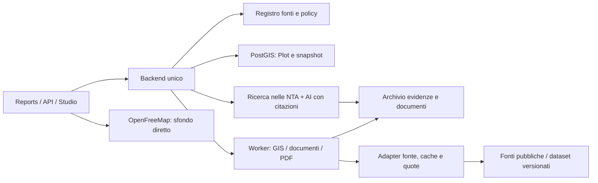

# Proposta backend per Particella

**Stato: proposta di ricerca, 5 ottobre 2026.** Nessuna implementazione, installazione, migrazione o deploy. Le scelte derivano dalle [fonti verificate](data-sources.md) e dalle [evidenze curl](evidence/2026-10-05/manifest.json). Disponibilità tecnica e licenza di riuso sono registrate separatamente.

## Obiettivo e scelta iniziale

Un backend condiviso per **Reports, API e Studio**, con analisi spaziale deterministica e AI che spiega risultati e documenti citati. Ogni risultato deve essere ricostruibile da input, versione delle fonti, metodo e risposta originale. “Fonte ufficiale” non significa “dato attuale”, e geometria catastale non determina edificabilità.

Propongo un **monolite modulare Python/FastAPI**, Postgres/PostGIS, un worker per ingestione/analisi/report e archivio oggetti per GML, raster, PDF ed evidenze. È una proposta, non una scelta già implementata. La motivazione è la disponibilità di strumenti GIS e parsing nel contesto Python, con SQL spaziale per intersezioni riproducibili. Se il team sceglie TypeScript per l'API, conservare PostGIS e un worker GIS separato senza riscrivere geometria numerica.

Inizialmente la coda può essere persistita in Postgres; Redis è opzionale quando servono scheduling/limiti distribuiti, non requisito per iniziare. Niente microservizi per ogni layer. Costi di compute/storage e gestione esistono anche se i dati sono gratuiti.



## Registro fonti: il contratto che precede gli adapter

Per ogni fonte, dataset e capacità mantenere `SourceDefinition`:

| Campo | Contenuto |
|---|---|
| `source_id / dataset_id / adapter_version` | Identità stabile; versione del parser distinta dalla release del dato |
| `publisher / authority / is_official` | Chi pubblica, ente titolare, ufficialità del dataset; mirror separato dal titolare |
| `base_url / documentation_url / protocol / layer_name` | URL ufficiali e layer/typeName/ID esatti |
| `capabilities` | identify_point, fetch_geometry, intersect_polygon, raster_sample, render; ciascuna con stato di verifica |
| `coverage` | Nazionale con eccezioni, Regione/Comune, extent, anni e completezza nota |
| `crs / axis_order / units / resolution / scale` | Semantica spaziale e numerica, non derivata a intuito dal formato |
| `license` | Nome/versione/URL, attribution, riuso commerciale, redistribuzione/derivati; unknown quando non accertato |
| `hosting_policy` | Quota, concorrenza, user agent, condizioni commerciali, chiave, CORS; separata dalla licenza dati |
| `release / updated_at / effective_from / effective_to` | Riferimento del dato e vigenza normativa; null esplicito dove ignoto |
| `verified_at / evidence_ref / verification_state` | Quale capacità è stata davvero verificata e con quale prova |
| `refresh_policy / timeout / circuit_breaker` | Pianificazione, controllo delle variazioni, comportamento ai guasti |

Per esempio IdroGEO: identify WMS verificato, WFS disabilitato, intersezione catastale completa da snapshot ancora da acquisire. Lombardia: query positiva ma licenza specifica incompleta e Tavola Previsioni non conformativa. Non rendere automaticamente scaricabile un dataset dalla licenza unknown soltanto perché il curl riesce.

Una fonte può essere mostrata come link di consultazione mentre l'export/API dei dati resta sospeso fino a verifica del riuso. Le condizioni note devono apparire sul risultato pertinente, senza nasconderle in una pagina generica.

## Modello Plot

`Plot` è l'oggetto scelto dall'utente, con revisioni. Può partire da punto, indirizzo, codice catastale o poligono caricato; la sua geometria non diventa “ufficiale” per il semplice caricamento.

| Campo | Tipo / significato |
|---|---|
| `id / revision / created_at / updated_at` | UUID, numero revisione, timestamp UTC |
| `input` | Tipo point/address/cadastral_reference/upload; valore originale e coordinate richieste |
| `selected_point` | GeoJSON Point 4326, ordine lon/lat; accuratezza/metodo geocoding e CRS originale |
| `geometry` | Polygon/MultiPolygon GeoJSON 4326 per API; PostGIS per analisi, hash e versione |
| `geometry_status` | unresolved / candidates / selected / ambiguous / outside_coverage |
| `geometry_origin` | official_cadastre / user_upload / user_drawn, source/result/evidence reference |
| `cadastral_units[]` | Codice catastale Comune, sezione se presente, riferimento mappa integrale, label foglio ufficiale, particella, INSPIRE ID, classe ordinaria/strada/acqua |
| `administrative_units[]` | Codice ISTAT **stringa sei cifre**, Comune, provincia, Regione, versione confini, metodo |
| `area / perimeter / centroid / measure_crs` | Valori derivati con unità/metodo; area geometrica non promossa a superficie censuaria |
| `selection_resolution` | Punto usato, candidati, decisione dell'utente, tolleranza, trasformazioni, bordi |
| `owner_workspace / visibility` | Accesso al progetto, ai documenti e report; nessun campo titolare catastale inferito |

Un progetto può aggregare più particelle, ma la relazione conserva ogni unità e non perde i confini per un'unione geometrica. Sul bordo comunale o su un lotto che attraversa comuni mantenere più giurisdizioni; nessuna scelta dal solo centroide.

### Risoluzione catastale, prima dell'analisi

1. Geocoding: preferire ANNCSU quando Comune/civico riconosciuti; gestire civici rossi/neri e coordinate mancanti. Fallback OSM etichettato; conferma del punto sulla mappa.
2. Comune: intersezione con ISTAT versionato, non campo municipality del reverse OSM (Rodano anomalo su Duomo nella prova).
3. Adapter catasto: GML WFS 6706, assi dichiarati; trasformazione geodetica corretta, bbox candidati.
4. `ST_Covers` dopo parsing/normalizzazione. Non selezionare prima feature o nearest polygon. Geometrie invalide archiviate e segnalate; eventuale riparazione produce nuova geometria derivata con metodo, senza sovrascrivere originale.
5. Mappa/foglio da zoning e label ufficiale: Milano LABEL 390, Firenze 173, rurale 60; identificativi `_039000`/`_017300`/`_006000` mantenuti integrali, niente parsing intuitivo degli zeri.
6. Strada/acqua: risultato esplicito e selezione alternativa del lotto, non “terreno edificabile”. Trento/Bolzano: outside_coverage dell'AdE, adapter autonomo da verificare.

Le prove hanno usato coordinate numericamente vicine tra WGS84 e 6706: ciò basta come audit di accesso, non come politica di precisione catastale del prodotto. Misure/intersezioni devono conservare CRS di origine e trasformazione applicata; tolleranza a bordo coerente con accuratezza cartografica.

## Modello LayerResult e provenance

Un `LayerResult` è l'esito **di una precisa analisi su una revisione del Plot**, non una copia senza contesto del JSON remoto.

| Campo | Significato |
|---|---|
| `id / plot_id / plot_revision / layer_id` | Identità e dipendenza dalla geometria selezionata |
| `status` | pending / ok / empty / outside_coverage / partial / unavailable / needs_auth / unsupported / unknown |
| `scope` | point / parcel / municipality / grid_cell / buffer / route; evita promozione dato comunale a lotto |
| `analysis_geometry_hash / parameters` | Geometria, radius, profilo, data/ora, scenario, percentile, orientamento, versione metodo |
| `features / measurements / summary` | Dati strutturati; unità, scala, risoluzione e precisione dichiarate |
| `coverage_fraction / nodata_fraction` | Copertura effettiva della geometria e raster; null quando non calcolata |
| `spatial_relation` | contains/intersects/nearby, area sovrapposta, distanza e CRS metrico |
| `provenance[]` | Fonte, ente, dataset/versione, licenza, data aggiornamento, URL, query/evidenza |
| `queried_at / analyzed_at / expires_at` | Consultazione e derivazione, separati da aggiornamento della fonte |
| `warnings / uncertainty / errors` | Motivi specifici, più candidati, atti mancanti, errore protocollo distinto dal dato |
| `cache_state / freshness` | live/cache/stale, scadenza e release; nessun refresh fittizio della data del dato |
| `method / method_version / parent_result_ids` | Derivazione, formula/interpolazione e catena risultati |
| `officiality / legal_relevance` | Ufficiale/OSM/upload; ricognitivo o disciplina documentata, non score AI di certezza |

Ogni fatto mostrato da summary, API o chat deve riferirsi a una o più provenance tramite ID, anche se più fonti confluiscono nello stesso layer. Questi campi minimi sono obbligatori:

```json
{
  "source_id": "ade.cadastre.wfs",
  "source_name": "Cartografia catastale INSPIRE",
  "authority": "Agenzia delle Entrate",
  "is_official": true,
  "license": {
    "name": "CC BY 4.0",
    "url": "https://creativecommons.org/licenses/by/4.0/",
    "attribution": "Agenzia delle Entrate"
  },
  "dataset_version": null,
  "updated_at": null,
  "queried_at": "2026-10-05T21:00:00Z",
  "url": "https://wfs.cartografia.agenziaentrate.gov.it/inspire/wfs/owfs01.php",
  "request_url": "<URL effettivamente chiamato, senza segreti>",
  "native_crs": "EPSG:6706",
  "evidence": {"sha256": "<hash risposta>", "object_ref": "<riferimento archivio>"},
  "temporal_note": "Aggiornamento live non dichiarato nella risposta"
}
```

È uno **schema illustrativo**, non un ulteriore risultato verificato né timestamp reale della chiamata. Un campo ignoto rimane null con motivo; queried_at non riempie updated_at. `beginLifespanVersion` di una feature è conservato nel suo significato originale. PDF/NTA hanno inoltre URL/hash, ente, piano/variante, delibera, bollettino/data efficacia e citazioni pagina/articolo.

**Semantica dei vuoti:** empty significa “query riuscita senza oggetti nel dataset/scenario/versione”; fuori regione è outside_coverage; timeout/DNS/503 è unavailable; HTTP 200 ServiceException è errore, non empty. Il lotto ha stato overall partial se mancano layer decisivi. Non esiste un overall “tutto sicuro” derivato dai layer vuoti.

## Pipeline spaziale e risultati numerici

Gli adapter traducono protocolli, non decidono cosa si può costruire. Separare fetch, parsing, normalizzazione, analisi GIS e sintesi.

- **Vettori**: intersect sull'intero poligono, percentuale superficie e features interessate. WMS point identify è screening; ottenere poligoni da WFS/REST/snapshot per conclusioni sul lotto.
- **DEM**: TINITALY terreno nudo 10 m; min/max/mediana, profilo, pendenza/aspect derivati da raster metrico. Dichiarare formula, risoluzione, NoData e campionamento; unità slope del WMS non confermata, quindi niente conversione automatica.
- **PAI/idraulica**: scenari separati e sovrapposizioni, senza mediare classi. Indicatori comunali mantenuti comunali; dataset versionato e licenza CC BY-SA pertinente.
- **Sismica**: join classe DPC al Comune; PGA MPS04 da nodi con nearest/interpolazione dichiarata. Non trasformare il primo nodo nella PGA puntuale, né classe comunale in requisito tecnico completo.
- **PVGIS**: database/anni/versione, inclinazione, azimuth, perdite, orizzonte; nessuna ombra locale di edifici/vegetazione implicitamente calcolata. Sole astronomico separato dall'irraggiamento.
- **Demografia/OMI**: supporto di contesto, griglia/comune/zona e semestre visibili. Nessuna attribuzione di residenti o prezzo al lotto.
- **POI/isocrone**: OSM distinto dai dati ufficiali; centro geometrico non ingresso. Modalità, minuti, grafo/versione e assenza di traffico/ZTL certe visibili.
- **Consumo suolo/CLC**: classi della release, non RGB; CLC a scala ampia non disciplina urbanistica. Ritagli/licenze/vincoli riuso delle ortofoto gestiti separatamente.

## Cache e snapshot

Due cache: **risposta della fonte** e **analisi derivata**. Chiave canonica = source/dataset/versione/adapter/request normalizzata; derivati includono hash geometria, metodo/versione e parametri. Aggiornare provider/release invalida solo dipendenze interessate.

| Dato | Strategia proposta | TTL / controllo iniziale |
|---|---|---|
| ISTAT confini, DPC, grid2021 | Snapshot immutabile per release in PostGIS | Check pagina settimanale/mensile; mai sovrascrivere versione |
| Catasto | GML comunale/semestrale + WFS mirato per aggiornamento | Cache live 24 h; stale massimo 7 giorni esplicito; registrare data ignota |
| ANNCSU | CSV mensile indicizzato + lookup giornaliero | Odonimi/civici 24 h; monitor mensile snapshot |
| Geocoding OSM/Photon | Cache query normalizzata e lingua | 30 giorni; adattatore sostituibile; quota globale |
| TINITALY | Tile raster release 1.1 immutabili | Derivati per hash/poligono/metodo |
| ISPRA/EEA/vincoli | Snapshot ufficiale per release e metadata/atto | Check aggiornamenti mensile; identify live 7 giorni |
| Urbanistica | Versione piano + varianti + documenti | Monitor pagina/atti settimanale; identify 24 h–7 giorni, stato vigenza separato |
| Popolazione | ZIP annuale/provinciale e revisioni | Check mensile, tag estimate/provisional |
| OMI | Perimetri/prezzi per semestre | Scoperta semestri settimanale; cache immutabile con gestione rettifiche |
| PVGIS | Parametri completi + API/db/versione | 90 giorni; invalidare se cambia dataset/metodo |
| Overpass | Area/categorie/query normalizzate | 1–7 giorni, conservare timestamp OSM |
| Routing/isocrone | Origine esatta, profilo, minuti, graph release | 1–7 giorni; non arrotondare senza dichiararlo |
| Tiles sfondo | HTTP cache del provider/browser | Seguire Cache-Control, non specchio massivo arbitrario |
| Errori | Cache negativa separata | 30–120 s + backoff; mai trasformarla in assenza del layer |

TTL sono **proposte**, non policy dei provider. Approvvigionamento limita chiamate per host nell'intera app: Nominatim 1/s, OpenTopoData 1/s e1000/giorno, OSRM1/s, SDMX5/min con margine. PVGIS30/s è tetto, non target: basso parallelismo. AdE/regioni senza numero: concorrenza prudente iniziale 1–2, timeout e circuit breaker configurabili.

Rispettare Retry-After, deduplicare richieste in corso, retry solo transienti con jitter e numero massimo. Distinguere HTTP error, exception XML, NoData e HTML inatteso. Conservare ETag/Last-Modified dove presenti. Stale può alimentare consultazione con avviso, ma non diventare “verificato oggi”. Uno snapshot report è immutabile e non cambia quando si aggiorna la cache.

## Client e server

| Chiamata | Posizione | Motivo |
|---|---|---|
| OpenFreeMap style/TileJSON/MVT | Client diretto | CORS verificato, niente chiave, evitare proxy dei tiles senza necessità |
| Overlay WMS con CORS | Client per sola visualizzazione, se licenza consente | Sfondi/overlay distinti da risultati backend; attribution |
| Catasto, ANNCSU, PVGIS, SITAP, Firenze, OpenTopoData, CopDEM | Server | CORS assente/incompatibile, parsing/CRS/cache e documentazione |
| REST ISTAT/EEA e query OSM/routing | Server per risultati | Anche con CORS positivo: riproducibilità, quote globali, privacy e cache |
| WMS senza CORS da usare in MapLibre/PDF | Proxy server specifico | WebGL/export immagini; allowlist fonti/capacità e limiti, nessun proxy URL arbitrario |
| ORS | Server | Chiave account segreta; quota e TOS, nessuna chiamata autenticata provata qui |
| Raster, intersezioni, profili, sole | Worker/server | Versioni/metodi condivisi fra report e API |
| Upload e RAG | Backend | Accesso workspace, hash, indicizzazione e citazioni |

CORS non concede permesso di riuso. Proxy può risolvere accesso browser ma non disponibilità, licenza, login o limite di hosting. La prova Open-Meteo anonima non rende gratuito il suo hosting per Particella commerciale. Per OSM/routing in produzione prevedere estratti/self-host o accordo/provider compatibile: demo pubblici non sono un SLA.

## Pianificazione urbanistica e RAG

Avvio consigliato con **due adapter comunali verificabili**, Milano e Firenze, senza promessa copertura normativa nazionale. Milano Tavola Previsioni è sintesi e licenza specifica da acquisire; procurare Piano delle Regole/Piano dei Servizi/NTA e atti ufficiali. Firenze PO ha query reale A1 e CC BY4, ma formati/GetMap e vigenza/varianti richiedono consolidamento.

La copertura si espande per scheda Comune con queste capacità separate: geometria zoning, norme ufficiali, vigenza/varianti, vincoli esterni. Regione Toscana “stato piani” non equivale a zoning; Torino verificato non copre Piemonte; PSC Emilia non equivale automaticamente a PUG; Veneto/Puglia ancora candidati.

`PlanningDocument` conserva ente/Comune ISTAT, tipo documento, piano, variante, titolo, URL origine, hash/versione, pubblicazione, atto/bollettino, efficacia, origine official_fetch/user_upload e stato della verifica. Per upload NTA PDF utente può indicare Comune/piano ma provenienza resta **upload**, vigenza non verificata. Non sostituire tacitamente documenti ufficiali con PDF caricati.

RAG:

1. Estrazione testo/OCR conservando pagina originale, intestazioni, articolo e allegati/tabelle.
2. Chunk su struttura normativa, non taglio cieco; ricerca lessicale + semantica filtrata per Comune/piano/variante/vigenza.
3. Recupero articoli collegati alla zona effettivamente intersecata, incluse definizioni, prescrizioni, rinvii ed eccezioni.
4. Risposta con citazione `document_id,version,page,article,url` e distinzione fra testo della norma, misura GIS e inferenza.
5. Citazioni controllate rispetto al testo recuperato; domanda senza norme sufficienti restituisce “documenti insufficienti” con elenco preciso dei mancanti.
6. Conflitto tra piano adottato/vigente/variante segnalato e mantenuto, senza decisione automatica dell'AI.

Documenti e risposte remote sono contenuto, non istruzioni operative al modello. Chat non modifica il registro fonti, non attesta vigenza, non invia pratiche o richieste agli enti. Indicatori come indice edificatorio, altezza, distanze e destinazioni ammesse diventano strutturati solo con riferimenti verificabili e condizioni; nessun “sì puoi costruire” basato su OMI/CLC o assenza di rischi.

## API, Reports e Studio

Contratto API proposto, non implementato:

- Creazione Plot da input e restituzione candidati/selezione.
- Richiesta analisi asincrona con elenco layer, stato per layer e progress.
- Lettura di `AnalysisSnapshot` immutabile: stessa revisione Plot, versioni fonte/metodo, tutti i LayerResult e copertura.
- Export JSON, generazione PDF e chat legati allo **stesso snapshot**, con eventuale nuova analisi esplicita.

REST versionata, GeoJSON lon/lat, unità esplicite, valori non disponibili null con motivo. Operazioni idempotenti per input/hash/parametri. API mostra fonte, ente, licenza, data del dato e URL su ogni risultato/fatto: niente pacchetto JSON senza provenance.

Studio usa la mappa per selezione e overlay, un pannello documenti versionati e chat che cita pagine. Report pubblico separato dai documenti privati. Upload/report/chat isolati per workspace; redazione di indirizzi/tokens nei log, retention delle ricerche configurata. Provider remoti ricevono solo quanto serve all'analisi; evidenze condivisibili senza chiavi/cookie.

### Struttura del report

1. **Identità del lotto**: punto/indirizzo, Comune/codici, particelle selezionate, mappa, area geometrica/metodo, tipo e provenienza della geometria.
2. **Copertura e sintesi**: cosa risulta dai dati, cosa manca, aggiornamenti ignoti e documenti necessari; nessuna certificazione di edificabilità.
3. **Disciplina urbanistica**: zone sovrapposte/percentuali, piano/variante/vigenza, destinazioni/parametri comprovati e citazioni NTA.
4. **Vincoli e rischi**: PAI/P1/P2/P3, sismica, paesaggio, Natura/parchi, incendi/contaminazioni se coperti; vuoti e indisponibilità distinti.
5. **Terreno e sole**: quote/profilo/pendenza/risoluzione, PVGIS con configurazione e orizzonte, eventuali lacune.
6. **Contesto**: servizi, isocrone, popolazione cella/comune e OMI zona/semestre, ciascuno con scala corretta.
7. **Fonti e metodo**: timestamp snapshot, licenze/attribuzioni, URL, release, hash/riferimenti evidenze e limiti pertinenti; fonti anche accanto al contenuto.

PDF generato dai dati strutturati e citazioni, AI limitata alla spiegazione. Attribution delle basemap e delle fonti mantenuta anche nelle immagini. Licenze CC BY-SA e ODbL gestite come obblighi specifici di dataset/derivati; nessuna relicenza automatica dell'intero pacchetto “open” sotto licenza del codice.

Per decisione operativa sul costruire serve verifica degli atti e dei documenti pertinenti, e dove necessario CDU/verifica tecnica presso Comune/professionista. È un passo concreto del flusso: elenco documenti e motivi, non disclaimer generico che copre conclusioni infondate.

## Sequenza di realizzazione e criteri di accettazione

1. Registro fonti, snapshot/evidenze e risoluzione punto→Comune→particella con candidati, strade e bordi. Import comunale catastale prima di carichi ampi.
2. Core deterministico: ISTAT, DPC, TINITALY, EEA, PVGIS; IdroGEO con snapshot/licenza della release. API JSON con provenance e report parziale onesto.
3. Due adapter urbanistici e documenti ufficiali/NTA; audit vigenza e licenze mancanti. Poi Studio/RAG e report con citazioni.
4. OMI semestrale, demografia, OSM/isocrone con hosting compatibile; estensione Regione per Regione guidata da evidenze e non numero di layer nella UI.
5. Extra acustica/incendi/contaminazione/sinkhole/calore solo con metadata/atti/licenza sufficienti.

Prima del rilascio verificare casi sostanziali: CRS/assi; punto sul bordo; lotto con più zone; strada urbana; Trento/Bolzano; WFS disabled dentro HTTP200; empty vs outside_coverage; raster NoData/RGB; codice ISTAT con zero; OMI anelli/semestre/L-N; PDF utente in conflitto con variante ufficiale; fonte stale; citazione che non supporta risposta. Le attuali prove curl verificano accesso e risposte, **non questi test di un prodotto che ancora va costruito**.

Monitor produzione per host: errori HTTP/protocollo, tempi, cambi schema/capabilities, età dati e copertura; controlli positivi/negativi noti e budget chiamate globale. Un aggiornamento di adapter o dataset genera nuova versione e mantiene i report precedenti leggibili.
